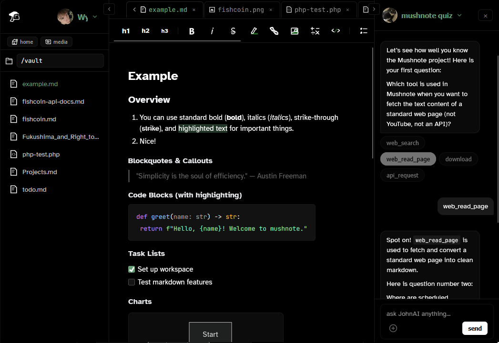

# mushnote

collaborative markdown notes on disk, real-time multi-user editing, and a built-in gemini agent—running natively in your browser via a lightweight chrome extension (`chrome-extension/`) where each note and ai web search lives in its own `"mushnote"` browser tab (`/editor/<path>`).

self-host for a **small group** — a couple, roommates, close friends — on one machine. not a thousand-user saas.

## use cases

| | |
|--|--|
|  **shared household notes** | one vault for todos, grocery lists, trip plans, and the random stuff you both need to find later |
|  **a household agent** | chat that can search, edit, and remember; personal memory lives in each user's `personality.md` |
|  **research into the vault** | web search and page reads that land as markdown notes, with sources you can keep |
|  **media in the same place** | drop images, pdfs, audio, video, and youtube downloads next to the notes that mention them |
|  **project notes on disk** | code files, configs, and markdown side by side; the agent can read, edit, clone repos, and call apis |
|  **ask about what you selected** | highlight text or drag a file into chat for a grounded answer without leaving the editor |

## screenshots



## features

**notes**
- vault is plain files (`.md`, code, json, etc.) under `vault/`
- wysiwyg editor with tabs, tasks, tables, math, images, `==highlights==`, note links
- file history with diffs in `history/` (hourly groups or every save, restore from the toolbar)
- deleted note tracker for files that left the vault (moves and renames still tracked)
- multi-user sync over websockets

**ai assistant**
- chat sidebar with streaming replies and tool badges
- vault tools for search, text read/edit/create, media analyze, move/copy/delete, history
- download files or public git repos into the vault; extract zip/jar/7z/rar; call http apis
- chat file uploads land in `media/chat-uploads/` as vault path refs (agent can analyze or link them into notes)
- personal memory lives in `system/<userid>/personality.md` (agent edits it like any other note)
- scheduled jobs as yaml under `system/<userid>/jobs/`
- optional web: google serp search (organic + ai overview), read public pages as markdown, youtube info/transcript/download
- context: open tabs, active note, weather, location, user memory

**accounts**
- users in `vault/system/config.yaml` (passwords hashed on save)
- admins can reach `system/` config and preferences

**mobile and pwa**
- installable progressive web app (pwa) on ios and android via add to home screen
- standalone mobile UI for quickly jotting down notes, checking off todos, or tracking calories on the go
- native push notification support for scheduled jobs and agent alerts, with one-tap opening directly to notes

**external api (v1)**
- register a dedicated user (`POST /api/v1/auth/register` with admin token or `registration_secret`)
- login --> bearer token --> list, read, put, patch notes under the vault
- see [docs/api-v1.md](docs/api-v1.md)

## agent tools

| icon | tool | what it does |
|------|------|--------------|
|  | `file_search` | search vault text by content/title/path, or media by filename/folder/`media_kind`/size; `recent=true` lists recently modified files |
|  | `web_search` | google search via chrome extension background tab (ai overview + organic results) |
|  | `web_read_page` | fetch an https url (in parallel) or read an open `tab_id` to clean markdown/images |
|  | `youtube_video` | youtube `info`, `transcript`, or `download` (audio/video) via yt-dlp |
|  | `download` | save an http(s) file into the vault, or shallow-clone a public git repo |
|  | `api_request` | http GET/POST/PUT/PATCH/DELETE for json or form apis; optional save response to vault |
|  | `eval_js` | execute sandboxed javascript for math, dates, timezones, data transformations, or calculations |
|  | `notify` | send a push notification to user devices (optional title, body, and note link) |
|  | `archive_extract` | unpack a vault `.zip`, `.jar`, `.7z`, or `.rar` into a folder next to it |
|  | `textfile_read` | read a text/code file; optional heading or line slice; `mode=outline` for headings only |
|  | `file_analyze` | load image/pdf/audio/video into gemini, or `mode=metadata` for size/dates/type |
|  | `tab_manage` | open, navigate, focus, or close vault notes and web urls in the `"mushnote"` tab group |
|  | `textfile_create` | create a new text file |
|  | `textfile_edit_diff` | targeted edits (replace, insert, delete, append; batchable) |
|  | `textfile_history` | browse edit history: hourly --> chunk --> revision snapshot |
|  | `file_move` | rename or move a file or folder |
|  | `file_copy` | copy a file or folder |
|  | `file_delete` | permanently delete a file or folder and its contents |

## why this stack

**gemini 3.5 flash lite** (`backend/agent/`)  
the agent runs a lot of turns: chat, tool calls, big file snippets, history compression. flash lite is built for **high volume at low cost** and still fast enough for day-to-day help. for a few people sharing notes, that matters more than the heaviest reasoning model.

**chrome extension** (`chrome-extension/` for `web_search`, `web_read_page`, `tab_manage`, and side panel)  
instead of external scraping proxies, mushnote uses a lightweight chrome extension that runs searches and page reads in background tabs inside the `"mushnote"` tab group using your own browser session, returning clean, token-bounded markdown, and exposes the ai side panel on any external tab in the group.

**on disk, not in a proprietary cloud**  
notes live in `vault/`. you get collaboration and an agent without locking content in someone else’s notebook product.

## cost (can stay free)

prices checked **2026-11-15**. vendors change these — verify on the linked pages before you budget.

| piece | free tier (what i use) | paid rate if you outgrow free | mushnote note |
|-------|------------------------|-------------------------------|---------------|
| **gemini 3.5 flash lite** ([pricing](https://ai.google.dev/gemini-api/docs/pricing)) | free input and output on the free tier in [ai studio](https://aistudio.google.com/) | **$0.30 / 1M** input, **$2.50 / 1M** output | default agent model; high-volume chat + tools |
| **chrome extension** (`chrome-extension/`) | **$0** (local) | — | powers `web_search`, `web_read_page`, and `"mushnote"` tab grouping using your browser session |
| **youtube / yt-dlp + ffmpeg** | bundled via npm (`youtube-dl-exec`, `ffmpeg-static`) | — | no youtube data api key |
| **mushnote itself** | **$0** (mit) | — | host on your pc or a small vps |

**what i actually pay right now:** **$0 / month** — gemini free tier for the agent, the local chrome extension for web search and page reading, and local yt-dlp/ffmpeg for downloads. a couple of light daily users fits that envelope. if you blow past free quotas, flash lite paid rates above are still cheap compared with bigger models.

## requirements

- **node.js 20+** (developed on node 24; 20 or 22 lts is fine)
- **os:** windows, macos, or linux
- **disk:** a writable `vault/` and `history/` path (defaults next to the repo)

**media dependencies (required):**

mushnote requires `yt-dlp` and `ffmpeg` on your `PATH` for video info, transcripts, audio extraction, and media conversions (the server will not start if either is missing):

```bash
# windows (winget)
winget install yt-dlp ffmpeg

# arch linux
sudo pacman -S yt-dlp ffmpeg

# debian / ubuntu
sudo apt update && sudo apt install yt-dlp ffmpeg

# macos (homebrew)
brew install yt-dlp ffmpeg
```

## setup

```bash
npm --prefix backend install
```

config lives at `vault/system/config.yaml` (copied from `resources/config.example.yaml` on first boot if missing).

### 1. gemini (required)

1. open [google ai studio](https://aistudio.google.com/) and create an api key.
2. in `vault/system/config.yaml`:

```yaml
gemini:
  api_key: "your-key"
  ai-username: ai
```

3. add human users under `users:` (see example). first admin can manage accounts in-app.

### 2. chrome extension (required on desktop)

mushnote uses a lightweight chrome extension (`chrome-extension/`) for desktop access, `"mushnote"` tab grouping, and live web search / page reading (`web_search`, `web_read_page`, `tab_manage`) using your own browser session.

1. open `chrome://extensions` in chrome (or edge/brave).
2. enable **developer mode** (top right).
3. click **load unpacked** and select the `chrome-extension/` folder from this repo.
4. visit your mushnote url once and log in—the extension will remember your origin automatically so clicking the toolbar icon toggles/focuses mushnote.

### 3. youtube (optional, no extra api)

the `youtube_video` tool supports `info`, `transcript`, or `download` (audio mp3 by default, video muxed webm when `media: video`; merged mp4 if `format: mp4`). works when youtube exposes captions and the video is public. no google youtube api billing. mushnote automatically detects system `yt-dlp` and `ffmpeg` from your PATH, falling back to local npm binaries if present.

### 4. run

```bash
npm --prefix backend start
```

dev with auto-restart:

```bash
npm --prefix backend run dev
```

open [http://localhost:3000](http://localhost:3000) on your lan so others can join (set `server.host` if you need to bind beyond localhost).

### 5. running as a linux service (systemd)

to run mushnote as a background daemon on linux that launches on boot:

1. create `/etc/systemd/system/mushnote.service`:

```ini
[Unit]
Description=Mushnote Service
After=network.target

[Service]
Type=simple
User=youruser
Group=youruser
WorkingDirectory=/home/youruser/mushnote/backend
ExecStart=/usr/bin/node server.js
Restart=always
RestartSec=5
Environment=NODE_ENV=production

# security hardening
NoNewPrivileges=true
ProtectSystem=full
ReadWritePaths=/home/youruser/mushnote

[Install]
WantedBy=multi-user.target
```

2. enable and start the service:

```bash
sudo systemctl daemon-reload
sudo systemctl enable --now mushnote
```

3. check logs:

```bash
journalctl -u mushnote -f
```

if using a reverse proxy like **caddy**, set `host: 127.0.0.1` in `vault/system/config.yaml` and proxy in your `Caddyfile`:

```caddyfile
notes.yourdomain.com {
    reverse_proxy 127.0.0.1:3000
}
```

## jobs setup

scheduled agent runs live as yaml files under `system/<userid>/jobs/`. filename (without `.yaml`) is the job name. each run opens a saved chat titled `JOB: <name>, <time>` (also the error log).

fields:
- `time` — daily local time (`HH:MM` 24h, or `7:00am`)
- `prompt` — what the agent should do when it fires

sample `system/wyatt/jobs/morning-brief.yaml`:

```yaml
time: "07:00"
prompt: |
  check todo.md and summarize what needs attention today
  if the weather looks rough, mention it briefly
```

create or edit jobs in the vault (or ask the agent to write them with `textfile_create` / `textfile_edit_diff`). the server watches the jobs folder and runs due jobs on its ticker.

## my personal setup

i run mushnote on a small server for me and my partner. our monthly cost is **$0**:

- **free domain**: a free subdomain from [freedns.afraid.org](https://freedns.afraid.org/) (such as `docdb.org`) pointed to our home ip
- **free https**: **caddy** as a reverse proxy that automatically provisions and renews let's encrypt certificates with zero extra config:

```caddyfile
ournotes.docdb.org {
    reverse_proxy 127.0.0.1:3000
}
```

- **free ai**: gemini 3.5 flash lite on the google ai studio free tier for daily chat and scheduling
- **free web and media**: bright data free tier for search, and native yt-dlp and ffmpeg for media
- **mobile pwa**: installed on our phone home screens as a standalone app, perfect for quickly jotting down notes, checking off groceries, or tracking calories on the go

## layout

| path | purpose |
|------|---------|
| `backend/` | express entry (`server.js`) |
| `backend/core/` | config, logger, auth |
| `backend/http/` | external api v1 routes |
| `backend/agent/` | gemini agent, tools, jobs |
| `backend/agent/chat/` | history compression, cite sanitize, titles |
| `backend/sync/` | yjs sync + markdown schema |
| `backend/vault/` | files, watcher, history, conversations |
| `backend/integrations/` | bright data, youtube, weather, ffmpeg |
| `frontend/` | editor ui (`index.html` login, `editor.html` workspace) |
| `frontend/css/` | split stylesheets (login loads a smaller set) |
| `frontend/js/core/` | boot, api, state |
| `frontend/js/workspace/` | files tree, tabs, layout, login, preview |
| `frontend/js/chat/` | assistant sidebar |
| `frontend/js/editor/` | note open/close, selection, dragdrop |
| `frontend/js/editor/rich/` | tiptap markdown editor + mermaid/math bundle |
| `frontend/js/editor/plain/` | codemirror for code files |
| `frontend/js/editor/collab/` | yjs sync, cursors, flash |
| `frontend/js/editor/media/` | images and media viewer helpers |
| `frontend/js/editor/history/` | history viewer and revision preview |
| `vault/` | notes and `system/config.yaml` |
| `history/` | version database |
| `resources/` | example config, default avatars, ui and tool icons, product shot |
| `docs/` | external api notes |

## license

[mit](LICENSE) — free to use, copy, modify, and ship. keep the copyright notice.
